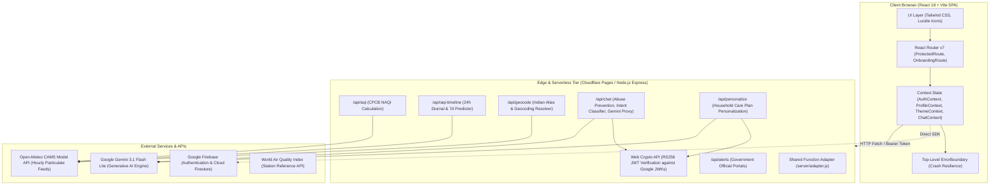

# 🏗️ Foggy — System Architecture & Technical Specifications

This document outlines the software architecture, data flow, component hierarchy, security protocols, and engineering decisions powering **Foggy**.

---

## 🏛️ High-Level Architecture Diagram

---

## 🔄 Core Data Flows

### 1. Indian National AQI (CPCB NAQI) Ingestion & Calculation

1. **Request**: The client queries `/api/aqi?city=Kolkata&lat=22.5726&lon=88.3639`.
2. **Upstream Ingestion**: The edge function fetches hourly particulate data ($PM_{2.5}$ and $PM_{10}$) from Open-Meteo's European Copernicus Atmosphere Monitoring Service (CAMS) model.
3. **CPCB Breakpoint Interpolation**: The server calculates piecewise linear sub-indices for each pollutant using the official CPCB NAQI breakpoints:
   $$I = I_{\text{low}} + \frac{I_{\text{high}} - I_{\text{low}}}{C_{\text{high}} - C_{\text{low}}} \times (C - C_{\text{low}})$$
4. **Highest-Sub-Index Rule**: Overall NAQI is assigned as the maximum sub-index among available criteria pollutants:
   $$\text{NAQI} = \max(I_{PM_{2.5}}, I_{PM_{10}})$$
5. **Rolling 24-Hour Average**: Hourly sub-indices across the last 24 observations are averaged to prevent transient weather anomalies from skewing health guidance.
6. **Deterministic Offline Simulation Fallback**: If upstream networks fail, the endpoint returns high-fidelity deterministic simulations keyed to Indian metropolitan seasonal baselines.

### 2. Location Matching & Alias Resolution

1. **Query Processing**: User searches e.g. `"Bangalore"`, `"New Delhi"`, or `"Orissa"`.
2. **Canonical Alias Mapping**: `shared/geocode.js` resolves historical and colonial aliases (`Bangalore` $\to$ `Bengaluru`, `Orissa` $\to$ `Odisha`, `Pondicherry` $\to$ `Puducherry`, `Bombay` $\to$ `Mumbai`).
3. **State Verification**: State names are normalized and matched using `statesMatch(state1, state2)` to prevent mismatched city/state selections.
4. **Fallback Dataset**: In offline environments or network interruptions, an embedded dictionary of 15 major Indian tier-1 and tier-2 metros provides instantaneous geocoding resolution.

### 3. Generative AI Chat & Intent-Driven Prompt Pipeline

1. **Intent Classification**: Incoming queries are categorized into deterministic intent types (`aqi_status`, `inversion_window`, `budget_options`, `diy_purifiers`, `mask_guidance`, `kids_or_seniors_safety`, `general_guidance`) via multilingual regex patterns supporting English, Hindi, and Hinglish.
2. **Compact JSON Context Block**: Instead of injecting raw text documents, an ultra-compact JSON block containing only verified atmospheric readings and profile tags is constructed.
3. **Prompt Injection Defense**: Adversarial tokens (`ignore previous instructions`, `DAN mode`, `system override`) are sanitized, and strict system rules mandate:
   - _"Answer the user's question first and directly."_
   - _"Never quote unverified or hallucinated AQI numbers."_
   - _"Never prescribe or alter medical dosage."_
4. **Hallucination Verification**: Responses are post-validated using `verifyModelAqiResponse` to ensure any quoted AQI figures match ground-truth context data.

---

## ⚖️ Architectural Decisions & Tradeoffs

| Decision                                              | Rationale                                                                                                                                                                                        | Tradeoffs / Mitigation                                                                                                                                               |
| :---------------------------------------------------- | :----------------------------------------------------------------------------------------------------------------------------------------------------------------------------------------------- | :------------------------------------------------------------------------------------------------------------------------------------------------------------------- |
| **Cloudflare Pages Functions + Express Local Server** | Enables zero-cost, lightning-fast edge deployments globally on Cloudflare Pages, while allowing simple local development with `node server/index.js` without requiring full wrangler emulation.  | Code duplication avoided by creating `server/adapter.js`, bridging Express requests to identical Web API `Request`/`Response` handlers.                              |
| **Web Crypto JWT Verification at Edge**               | Validates Firebase ID tokens cryptographically against Google's public JWK certificates (`RSASSA-PKCS1-v1_5`) without importing bulky Node.js libraries (`jsonwebtoken`, `google-auth-library`). | Requires fetching and caching Google's public keys in memory (`https://www.googleapis.com/robot/v1/metadata/jwk/securetoken@system.gserviceaccount.com`).            |
| **Open-Meteo CAMS Model Feed**                        | Completely keyless, high-reliability atmospheric data with global coverage and fine-grained hourly particulate readings.                                                                         | Model data can differ slightly from physical ground stations; addressed by prominently disclaiming modeled vs station data and providing WAQI cross-reference links. |
| **Client-Side Sensitive Health Data Isolation**       | Respiratory vulnerabilities (asthma, COPD, cardiovascular conditions) are kept in local storage keyed to the user's UID rather than broadcast to external databases.                             | Reduces multi-device sync until optional encrypted cloud backup is configured; preserves absolute user privacy.                                                      |
| **1-Click Offline Demo Account**                      | Reviewers, automated evaluators, and prospective users can test complete personalized workflows instantly without creating real Firebase credentials.                                            | Stored in isolated in-memory/localStorage state; prevents pollution of production Firebase databases.                                                                |

---

## 🔒 Security & Edge Guardrails

1. **Dual Rate Limiting**:
   - Anonymous visitors: 10 requests / hour per client IP.
   - Authenticated users: 60 requests / hour with validated Firebase Bearer token.
2. **Strict Payload Limits**:
   - HTTP body capped at 32 KB (`413 Payload Too Large`).
   - Chat message capped at 500 characters (`400 Bad Request`).
   - History trimmed to the last 10 conversation turns.
3. **Content Security Policy (CSP)**:
   - Configured in `public/_headers` with restrictive directives (`default-src 'self'`, script/font/connect restrictions, frame-ancestors `'none'`).
4. **Clinical Safety Guardrails**:
   - All care plans, chat responses, and UI banners enforce strict disclaimers that Foggy is an AI companion, not a medical professional, directing emergencies to 112 / 108.
