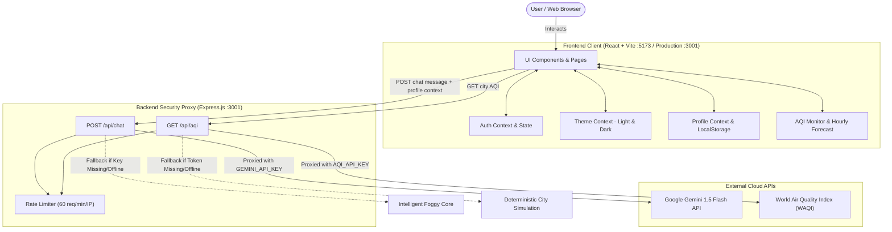

# 🌫️ Foggy — GenAI Winter Smog & Urban Air Quality Assistant

[](https://opensource.org/licenses/MIT)
[](https://reactjs.org/)
[](https://vitejs.dev/)
[](https://tailwindcss.com/)
[](https://expressjs.com/)
[](https://aistudio.google.com/)
[](https://aqicn.org/api/)
[](https://www.w3.org/WAI/WCAG2AA-Conformance)

> **"Breathe easier, live cleaner, protect who you love."**  
> Foggy is a friendly, knowledgeable, and reassuring GenAI companion designed to help families and urban communities navigate severe winter smog and urban air pollution with personalized routines, budget-friendly indoor hacks, and transparent impact metrics.

---

## 📖 Table of Contents
- [The Problem](#-the-problem)
- [Meet Foggy: Your AI Companion](#-meet-foggy-your-ai-companion)
- [Key Features](#-key-features)
- [Screenshots & UI Walkthrough](#-screenshots--ui-walkthrough)
- [Tech Stack](#-tech-stack)
- [System Architecture](#-system-architecture)
- [Folder Structure](#-folder-structure)
- [Getting Started & Local Setup](#-getting-started--local-setup)
- [Deploy to Cloudflare Pages](#-deploy-to-cloudflare-pages)
- [API Keys & Secrets Setup Guide](#-api-keys--secrets-setup-guide)
- [Light & Dark Mode Palettes](#-light--dark-mode-palettes)
- [Authentication & Memory Architecture](#-authentication--memory-architecture)
- [Privacy & Sensitive Health Data Statement](#-privacy--sensitive-health-data-statement)
- [Usage Guide](#-usage-guide)
- [Future Roadmap](#-future-roadmap)
- [Contributing](#-contributing)
- [License](#-license)

---

## ❄️ The Problem
Every winter, hundreds of urban valleys and metropolitan centers experience catastrophic air quality deterioration driven by **temperature inversions**. A layer of warm air settles aloft like an atmospheric lid, trapping cold, dense air—and with it, heavy vehicle exhaust, residential wood/coal smoke, and industrial particulate matter—at street level.

Particulate matter ($PM_{2.5}$) is small enough ($\le 2.5\,\mu\text{m}$) to bypass nasal cilia, penetrate deep into bronchial alveoli, and enter the circulatory bloodstream. This causes acute asthma flare-ups, vascular inflammation, and chronic pulmonary damage—especially in vulnerable populations like children, seniors, and individuals with respiratory conditions.

Commercial advice often promotes costly purifiers ($400+) or causes anxiety without actionable, community-scale solutions. **Foggy** bridges this gap by delivering reassuring, practical, low-cost guidance and quantifying the exact environmental and health impact of every choice.

---

## ☁️ Meet Foggy: Your AI Companion
**Foggy** is not a sterile dashboard or an alarmist siren. Foggy is an empathetic, knowledgeable air quality ally with a warm, practical personality:
- **Never Alarmist**: Always focuses on what you *can* do today rather than inducing climate anxiety.
- **Direct Impact Explainer**: Quantifies every recommendation (e.g., *"Taking the metro saves ~2.4 kg CO2 and cuts your direct $PM_{2.5}$ exposure by 65%"*).
- **Health-Conscious with Safety Disclaimers**: Clarifies it is an AI assistant, not a physician, encouraging users to consult doctors for medical symptoms.
- **Personalized Context Memory**: Remembers your city, family members (asthma, seniors, infants, pets), heating style, and commute method across sessions so you never repeat yourself.

---

## ✨ Key Features

### 1. 🤖 Foggy Personalized Assistant (GenAI Chat)
- Conversational chat powered by **Google Gemini API** (`gemini-1.5-flash`), with an intelligent built-in fallback core when keys are unset or offline.
- Greets signed-in users by their first name and adapts recommendations to their household profile.
- Branded Foggy mascot avatar with emotional states (happy, listening, thinking).
- Suggested starter prompts: *"Plan my low-pollution day"*, *"How do I clean my home's air on a budget?"*, *"What mask should I wear today?"*.

### 2. 🕒 Low-Emission Daily Routines
- Hour-by-hour schedule covering commute, home heating, cooking, and outdoor exercise timing.
- **24-Hour Smog Inversion Curve**: Identifies peak smog windows (morning & evening inversions) and pinpoints the optimal midday window (1:00 PM – 3:30 PM) when solar radiation breaks the ground-level lid.
- Cleaner alternatives: public transit, cycling, carpooling, and induction cooking over coal/wood burning.

### 3. 🛠️ Budget-Friendly Indoor Air Hacks
- **The Corsi-Rosenthal Box**: Step-by-step DIY box-fan filter builder that matches $400 HEPA Clean Air Delivery Rates (CADR) for under $35-$50.
- **Micro-Gap Sealing**: Roll damp towels and apply weatherstripping to slash passive particulate drafts by up to 50% for $0 to $12.
- **Inversion Ventilation Timing**: Scientifically-timed window airing protocol.
- **Air-Purifying Botanical Companions**: Snake Plants (nighttime oxygen), Spider Plants (pet-safe formaldehyde absorption), and Areca Palms.
- **N95/FFP2 Mask Rotation**: Safe 4-day rotating paper bag protocol allowing safe re-use up to 40 hours.

### 4. 📊 Direct Impact Explainer
Every recommendation features visual badges detailing:
- **Estimated Emission Savings**: e.g. `~2.4 kg CO2 saved`
- **Health Inhalation Reduction**: e.g. `-65% PM2.5 inhaled`
- **Cost/Time Tradeoff**: e.g. `Save $3.50 vs solo driving`

### 5. 🌍 Location-Aware AQI Display
- Color-coded severity gauge (Good, Moderate, Unhealthy for Sensitive Groups, Unhealthy, Very Unhealthy, Hazardous) following US EPA standards.
- Real-time station integration via the **World Air Quality Index (WAQI) API**.
- Seamless fallback to high-fidelity regional atmospheric simulation models with clear source badges (`Live Sensor Feed` vs `Simulation Mode`).
- Direct injection of today's AQI and pollutants ($PM_{2.5}, PM_{10}, NO_2, O_3, SO_2, CO$) into Foggy's LLM prompt context.

### 6. 👨‍👩‍👧‍👦 Family Health Profiles
- Maintain profiles for dependents (children, elderly parents, asthmatics, pets, pregnant members).
- Assign customized sensitivity levels (`High`, `Moderate`, `Standard`) and personal activity notes.
- Automatic risk score calculation based on current AQI.

### 7. 🧠 Memory & Personalization ("What Foggy Knows")
- **Dynamic Memory Extraction**: Mentions of household details in chat (e.g. *"my father has COPD"* or *"we have a wood fireplace"*) trigger a polite suggestion chip: `💡 Foggy noticed: Father (COPD). [Save to Profile]`.
- **Transparent Inspector**: View, edit, or delete individual memories at any time.
- **One-Click Privacy Wipe**: Clear all stored data with a single button.

### 8. 🌗 Light & Dark Theme
- Navbar Sun/Moon toggle with smooth CSS transitions.
- Strictly adheres to the project color specification with WCAG AA compliance.

---

## 📸 Screenshots & UI Walkthrough

| Landing Page (Hero & Value Props) | Live AQI Dashboard & Daily Routine |
| :---: | :---: |
| *(Clean misty atmospheric backdrop, mascot avatar, quick-login)* | *(Real-time AQI meter, 24-hr inversion timeline, impact badges)* |

| GenAI Foggy Chat & Memory Extraction | Family Profiles & Vulnerabilities |
| :---: | :---: |
| *(Interactive conversation, starter pills, memory chips)* | *(Child with asthma, senior cardio, pet sensitivity tags)* |

| Budget Indoor Air Hacks (Corsi-Rosenthal) | "What Foggy Knows" Privacy Inspector |
| :---: | :---: |
| *(Step-by-step DIY box fan builder, cost vs HEPA)* | *(Transparent attributes, memory log, one-click data wipe)* |

---

## 💻 Tech Stack

- **Frontend**: React 18, Vite 5, Tailwind CSS 3.4, React Router 7, Lucide Icons
- **Backend Proxy**: Node.js 24, Express 4.21, CORS, Dotenv, In-memory Sliding Window Rate Limiter
- **AI Engine**: Google Gemini API (`gemini-1.5-flash`) via secure backend proxy + Built-in Atmospheric Core Fallback
- **Air Quality Data**: World Air Quality Index (WAQI) API (`https://api.waqi.info`) + High-Fidelity Simulation Fallback
- **State & Storage**: React Context API (`ThemeContext`, `AuthContext`, `ProfileContext`) + `localStorage` persistence layer

---

## 🏛️ System Architecture



---

## 📂 Folder Structure

```
challenge6/
├── .env.example               # Client build-time variable templates (VITE_FIREBASE_*)
├── .dev.vars.example          # Cloudflare Pages Functions local secrets template
├── .gitignore                  # Git ignore rules (node_modules, .env, .dev.vars, dist)
├── .node-version               # Target Node version for Cloudflare Pages (Node 20)
├── wrangler.toml               # Cloudflare Pages & Functions configuration
├── _routes.json                # Cloudflare routing rules (/api/* -> Functions, rest -> static)
├── package.json                # Project dependencies, Node 20 engine, and npm scripts
├── postcss.config.js           # PostCSS configuration
├── tailwind.config.js          # Tailwind CSS theme configuration
├── vite.config.js              # Vite bundler & API proxy configuration
├── README.md                   # Complete documentation
│
├── functions/                  # Cloudflare Pages Functions (Serverless Edge API)
│   └── api/
│       ├── aqi.js              # Edge WAQI API proxy with live sensors, rate limiting & validation
│       └── chat.js             # Edge Gemini GenAI proxy with memory extraction & rate limiting
│
├── public/                     # Static assets copied into dist/ at build time
│   ├── _headers                # Security headers (CSP, HSTS, X-Frame-Options, etc.)
│   ├── _redirects              # SPA fallback rules (/* /index.html 200)
│   └── _routes.json            # Cloudflare Pages Function routing rule definition
│
├── server/                     # Local Backend Proxy (Express.js fallback bridge)
│   ├── index.js                # Express app entry, static serving & routes
│   ├── middleware/
│   │   └── rateLimiter.js      # Sliding-window IP rate limiting
│   └── routes/
│       ├── aqi.js              # Route mounted to /api/aqi (bridges to functions/api/aqi.js)
│       └── chat.js             # Route mounted to /api/chat (bridges to functions/api/chat.js)
│
└── src/                        # Frontend source code (React + Vite)
    ├── main.jsx                # App initialization & Context mounting
    ├── App.jsx                 # Route declarations & layout structure
    ├── index.html              # HTML entry & favicon definition
    ├── styles/
    │   └── index.css           # CSS variables, animations, and Tailwind directives
    ├── context/
    │   ├── AuthContext.jsx     # User session, login, signup, demo login
    │   ├── ThemeContext.jsx    # Light (#F1F5F9) & Dark (#0F172A) toggle
    │   ├── ProfileContext.jsx  # Family members, memory facts, profile attributes
    │   └── ChatContext.jsx     # Shared conversational state & modal controls
    ├── services/
    │   └── api.js              # Resilient fetch clients (calls /api/aqi and /api/chat)
    ├── components/
    │   ├── Navbar.jsx          # Responsive header, theme switch, user profile
    │   ├── MobileBottomNav.jsx # Native thumb-friendly bottom navigation bar
    │   ├── CompactChatModal.jsx # Floating compact chat window with bottom-sheet mobile docking
    │   ├── FloatingChatButton.jsx # Circular assistant launcher button
    │   ├── CursorAtmosphere.jsx # Interactive particulate physics & clean air torch
    │   ├── Footer.jsx          # Legal notices, medical disclaimer, links
    │   ├── MascotAvatar.jsx    # Foggy cloud mascot SVG with emotion states
    │   ├── ThemeToggle.jsx     # Sun/Moon accessible switcher
    │   ├── AQICard.jsx         # Live gauge, pollutants breakdown, city search
    │   ├── HourlyTimeline.jsx  # 24-hr smog inversion curve & best windows
    │   ├── ImpactBadge.jsx     # CO2, PM2.5, and cost tradeoff badges
    │   ├── MemoryNotification.jsx # "Foggy noticed..." interactive 1-click save
    │   └── ProtectedRoute.jsx  # Guarded navigation wrapper
    └── pages/
        ├── LandingPage.jsx     # Hero, value props, live preview
        ├── AuthPage.jsx        # Sign In / Sign Up with validation & 1-click demo
        ├── DashboardPage.jsx   # AQI card, daily routine, family alert
        ├── ChatPage.jsx        # Focused consultation view with compact messenger
        ├── IndoorHacksPage.jsx # Budget DIY filters, sealing, plants, masks
        ├── FamilyProfilesPage.jsx # Household health management
        ├── MemoryPage.jsx      # "What Foggy Knows" privacy inspector
        └── AboutPage.jsx       # Inversion physics, AQI chart, medical disclaimer
```

---

## 🚀 Getting Started & Local Setup

### Prerequisites
- **Node.js** v20.0.0 or later (configured in `.node-version`)
- **pnpm** (or `npm` / `yarn`)

### 1. Clone & Install
```bash
git clone https://github.com/your-username/foggy.git
cd foggy

# Install dependencies with pnpm
pnpm install
```

### 2. Configure Local Secrets & Environment
Foggy uses two configuration files for clean security boundaries:
1. **Local Function Secrets (`.dev.vars`)**:
   Used by Wrangler (`wrangler pages dev dist`) to securely provide backend secrets to Cloudflare Pages Functions:
   ```bash
   cp .dev.vars.example .dev.vars
   ```
   *(Windows PowerShell: `Copy-Item .dev.vars.example .dev.vars`)*
   Add your keys:
   ```env
   GEMINI_API_KEY=your_gemini_api_key_here
   AQI_API_KEY=your_waqi_token_here
   ```
   > 💡 *Note: The application operates gracefully with built-in high-fidelity atmospheric simulation and smart AI fallback models even if keys are left blank!*

2. **Client Build Configuration (`.env`)**:
   Used by Vite at build time for public web client variables (such as Firebase Authentication):
   ```bash
   cp .env.example .env
   ```
   *(Windows PowerShell: `Copy-Item .env.example .env`)*

### 3. Run Locally with Cloudflare Pages Functions (Wrangler)
Build the frontend and run the complete Cloudflare Pages environment (static assets + Edge Pages Functions) locally:
```bash
# 1. Build the production assets into dist/
pnpm run build

# 2. Run the site and functions locally with Wrangler
pnpm run pages:dev
```
Your local Cloudflare Pages environment will be live at `http://localhost:8788`, executing `functions/api/aqi.js` and `functions/api/chat.js` with full Edge runtime parity!

### 4. Alternative: Run with Vite Dev Server & Local Proxy
For hot-module replacement (HMR) during frontend UI editing:
```bash
pnpm run dev
```
- Frontend dev server: `http://localhost:5173`
- Local API proxy bridge: `http://localhost:3001`

---

## ⚡ Deploy to Cloudflare Pages

Foggy is fully optimized for continuous deployment on **Cloudflare Pages** with Cloudflare Pages Functions in `functions/api/`.

### Architecture on Cloudflare Pages
* **Edge Static Assets**: Pre-compiled with Vite into `dist/` and served globally via Cloudflare's ultra-low latency CDN edge network.
* **Pages Functions (Edge Workers)**: Located in `functions/api/`:
  - `functions/api/chat.js` handles Google Gemini GenAI interactions, safety disclaimers, rate limiting, request size limits, and dynamic profile memory extraction.
  - `functions/api/aqi.js` handles World Air Quality Index (WAQI) live station feeds, key pollutants ($PM_{2.5}, PM_{10}, NO_2, O_3, SO_2, CO$), rate limiting, input validation, and inversion curve modeling.
* **Zero Secret Leakage**: Secret keys (`GEMINI_API_KEY`, `AQI_API_KEY`) are stored strictly server-side in Cloudflare Pages Secrets (`context.env`). **No secret keys ever use `VITE_` or `NEXT_PUBLIC_` prefixes**, ensuring credentials are never exposed in browser bundles.
* **SPA Routing & Security**:
  - `public/_redirects`: Provides the SPA fallback rule (`/* /index.html 200`) so refreshing `/dashboard`, `/family`, `/memory`, or `/about` never produces a 404 error.
  - `public/_routes.json`: Directs `/api/*` to Cloudflare Pages Functions while routing all other requests to static assets.
  - `public/_headers`: Enforces strict security headers (`Content-Security-Policy`, `X-Content-Type-Options: nosniff`, `X-Frame-Options: DENY`, `Referrer-Policy: strict-origin-when-cross-origin`). The CSP is pre-configured to allow Firebase Authentication popups and Google Sign-In.
* **Rate Limiting**: Built-in best-effort in-memory sliding-window rate limiting (60 requests/minute per IP) protects API quotas. Stronger, distributed edge rate limiting can be configured directly in Cloudflare's dashboard under **Security > WAF > Rate limiting rules**.

---

### Step-by-Step Deployment Instructions

#### 1. Push to GitHub
Commit your project and push to your GitHub repository:
```bash
git add .
git commit -m "Migrate hosting to Cloudflare Pages"
git push origin main
```

#### 2. Create Cloudflare Pages Project
1. Log in to the [Cloudflare Dashboard](https://dash.cloudflare.com/).
2. In the left navigation, go to **Workers & Pages** > **Create application** > **Pages** > **Connect to Git**.
3. Select your GitHub account and choose the `foggy` repository.
4. Click **Begin setup**.

#### 3. Configure Build Settings
Fill in the build configuration:

| Setting | Value | Notes |
| :--- | :--- | :--- |
| **Project Name** | `foggy` | Or your preferred subdomain |
| **Production Branch** | `main` | Continuous deployment branch |
| **Framework Preset** | `Vite` (or `None`) | Configured via `package.json` |
| **Build Command** | `npm run build` | Produces production assets in `dist/` |
| **Build Output Directory** | `dist` | Static asset output directory |
| **Node.js Version** | `20` | Automatically picked up from `.node-version` |

#### 4. Configure Environment Variables & Secrets
Under **Environment variables (advanced)**:

1. **Add Production Secrets (Server-Side)**:
   - `GEMINI_API_KEY`: Your Google AI Studio Gemini API key (e.g. `AIzaSy...`)
   - `AQI_API_KEY`: Your WAQI API platform token (e.g. `67a5...`)
   *(Mark both as **Encrypt** / Secret)*

2. **Add Client Build-Time Variables (Public Web Config)**:
   If using Firebase Authentication, add the public web configuration:
   - `VITE_FIREBASE_API_KEY`
   - `VITE_FIREBASE_AUTH_DOMAIN`
   - `VITE_FIREBASE_PROJECT_ID`
   - `VITE_FIREBASE_STORAGE_BUCKET`
   - `VITE_FIREBASE_MESSAGING_SENDER_ID`
   - `VITE_FIREBASE_APP_ID`

> 🔒 **Security Notice**: Secret keys (`GEMINI_API_KEY`, `AQI_API_KEY`) must **NEVER** use the `VITE_` prefix. `VITE_` is reserved solely for public client-side web config that Vite embeds into the frontend bundle.

#### 5. Deploy & Authorize Firebase Domain
1. Click **Save and Deploy**. Cloudflare Pages will build the frontend, deploy the `functions/api/` edge routes, and provide your live URL (e.g. `https://foggy.pages.dev`).
2. **Authorize Domain in Firebase**:
   - Go to [Firebase Console](https://console.firebase.google.com/) > Select your Project.
   - Navigate to **Authentication** > **Settings** > **Authorized domains**.
   - Click **Add domain** and enter your Cloudflare Pages domain (e.g. `foggy.pages.dev`).
   - This ensures Google OAuth popups and redirects function without origin rejection.

---

## 🔑 API Keys & Secrets Setup Guide

### 1. Google Gemini API Key (GenAI Chat)
1. Navigate to [Google AI Studio](https://aistudio.google.com).
2. Sign in with your Google account.
3. In the left navigation, click **"Get API key"**, then **"Create API key in new project"**.
4. Copy your key and paste it into `.env`:
   ```env
   GEMINI_API_KEY=AIzaSy...
   ```
> 💡 *Note: Google AI Studio offers a free tier with rate limits. If the key is omitted or the quota is exhausted, Foggy automatically uses its built-in rule and template engine so the app remains completely operational.*

### 2. World Air Quality Index (WAQI) Token
1. Navigate to the [WAQI Data Platform Token Form](https://aqicn.org/data-platform/token/).
2. Agree to the non-commercial terms of service.
3. Enter your Name and Email address, then submit.
4. Check your email inbox and click the confirmation link to activate your free token.
5. Copy your token and paste it into `.env`:
   ```env
   AQI_API_KEY=your_token_here
   ```
> 💡 *Note: If no token is provided, Foggy seamlessly falls back to realistic regional atmospheric simulation data clearly marked with an informative badge.*

### ⚠️ Security Warning
- **Never commit your `.env` file** or share your keys publicly. The `.gitignore` file is configured to exclude all `.env` files.
- If you accidentally expose an API key, revoke and regenerate it immediately in Google AI Studio or the WAQI console.

---

## 🎨 Light & Dark Mode Palettes

Foggy's visual styling reflects the cool, crisp, misty atmosphere of winter smog while ensuring high contrast and readability:

| Mode | Token | Hex Color | Role |
| :--- | :--- | :--- | :--- |
| **Light** | Crisp Fog | `#F1F5F9` | Primary Background |
| **Light** | Dense Mist | `#E2E8F0` | Secondary Background / Layering Cards |
| **Light** | Slate Charcoal | `#334155` | Primary Readable Body Text |
| **Light** | Haze Orange | `#D97706` | Accent Buttons & Warning Elements |
| **Dark** | Midnight Smog | `#0F172A` | Primary Background |
| **Dark** | Industrial Haze | `#1E293B` | Secondary Background / Layering Cards |
| **Dark** | Ice White | `#F8FAFC` | Primary Crisp Text |
| **Dark** | Ozone Blue | `#38BDF8` | Primary Interactive Elements |
| **Dark** | Toxic Yellow | `#FBBF24` | Urgent AQI Alerts & Inversion Warnings |

---

## 🔐 Authentication & Memory Architecture

### Authentication Flow
1. **Mock Session Store**: User authentication is persisted in `localStorage` under `foggy_session_user`.
2. **One-Click Demo Login**: Includes a `Quick 1-Click Demo Login (Maya Chen)` button for immediate review without typing credentials.
3. **Form Validation**: Validates email format and requires a minimum 6-character password with user-friendly error banners.
4. **Protected Routes**: Dashboard, Chat, Family Profiles, and Memory pages are guarded by `ProtectedRoute`.

### Memory & Personalization Flow
1. **Context Bundling**: On every chat message, the frontend bundles the user's city, current AQI metrics, and family health vulnerabilities into the payload.
2. **Extraction Engine**: Foggy scans chat messages for new family health mentions (e.g., *"my daughter has asthma"*), heating appliances, or commute changes.
3. **User Confirmation**: The UI renders a floating banner (`💡 Foggy noticed...`) asking for user permission before permanently recording any fact.
4. **Context Limits**: Older conversation turns are trimmed to retain recent relevance while staying well within Gemini token limits.

---

## 🛡️ Privacy & Sensitive Health Data Statement

Foggy recognizes that respiratory conditions (asthma, COPD, cardiovascular illness) are sensitive personal health information:
- **Local Storage Only**: In this release, all health tags and extracted facts are stored **exclusively in your browser's local storage**.
- **No Data Brokering**: We do not sell, broker, or transmit your family health details to data collectors.
- **Model Training Privacy**: System context is passed via Google Gemini API endpoints without opting into public dataset training.
- **Full Erasure Control**: Users can inspect every recorded fact on the *What Foggy Knows* page and execute a complete wipe with the **"Clear All My Data"** button.

---

## 📘 Usage Guide

1. **Sign In**: Launch the app and click **"Try 1-Click Demo Profile"** or create a new account.
2. **Check the Dashboard**: Review your local AQI score, the 24-hour inversion curve, and the recommended low-emission daily routine.
3. **Chat with Foggy**: Ask Foggy to plan your day, provide a budget DIY purifier recipe, or evaluate if it is safe for your child to play soccer outside today.
4. **Explore Indoor Hacks**: Select the *Indoor Hacks* page to view instructions for building a Corsi-Rosenthal box for under $35.
5. **Manage Family**: Add household members with conditions like asthma so Foggy automatically factors them into outdoor advisories.
6. **Inspect Memory**: Open *What Foggy Knows* to inspect and manage the facts Foggy has learned.

---

## 🗺️ Future Roadmap

- [ ] **Cloud Backend & Database**: Migrate local storage to a secure Supabase / Firebase backend for cross-device synchronization with end-to-end encryption (E2EE) for health records.
- [ ] **Multi-Station Sensor Aggregation**: Integrate OpenAQ, AirNow, and PurpleAir alongside WAQI for hyper-local neighborhood sensor resolution.
- [ ] **Push & SMS Smog Alerts**: Deliver morning inversion warnings before users leave for their daily commute.
- [ ] **Voice Interface**: Hands-free voice chat with Foggy for kitchen and car accessibility.
- [ ] **Localized School & Transit Feeds**: Sync district outdoor recess decisions with live school sports schedules.

---

## 🤝 Contributing

Contributions are welcome! Please follow these steps:
1. Fork the repository.
2. Create a feature branch (`git checkout -b feature/amazing-hack`).
3. Commit your changes (`git commit -m 'feat: Add Corsi-Rosenthal filter size calculator'`).
4. Push to your branch (`git push origin feature/amazing-hack`).
5. Open a Pull Request.

---

## 👨‍💻 Developer & Authors
Developed with ❤️ by **Rishav Nandi** — empowering families and communities to navigate severe smog with accessible GenAI and practical science.

---

## 📄 License
This project is open-source and distributed under the **MIT License**. See the `LICENSE` file for details.

---

*Foggy — Because everyone deserves clean air, practical solutions, and peace of mind.*
