# 🌫️ Foggy — GenAI Winter Smog & Urban Air Quality Assistant

[](https://github.com/Rishav-coder-ops/foggy/actions/workflows/ci.yml)
[](https://github.com/Rishav-coder-ops/foggy)
[](https://github.com/Rishav-coder-ops/foggy)
[](https://nodejs.org/)
[](https://pnpm.io/)
[](https://opensource.org/licenses/MIT)
[](https://reactjs.org/)
[](https://vitejs.dev/)
[](https://tailwindcss.com/)
[](https://expressjs.com/)
[](https://aistudio.google.com/)
[](https://www.w3.org/WAI/WCAG2AA-Conformance)
[](https://github.com/Rishav-coder-ops/foggy)

🌐 **Live Production Application**: [https://foggy-278.pages.dev](https://foggy-278.pages.dev)

> **"Breathe easier, live cleaner, protect who you love."**  
> Foggy is a friendly, knowledgeable, and reassuring GenAI companion designed to help families and urban communities navigate severe winter smog and urban air pollution with personalized routines, budget-friendly indoor hacks, and transparent impact metrics.

---

## 📖 Table of Contents

- [The Problem](#-the-problem)
- [Meet Foggy: Your AI Companion](#-meet-foggy-your-ai-companion)
- [Key Features](#-key-features)
- [Tech Stack](#-tech-stack)
- [System Architecture](#-system-architecture)
- [Folder Structure](#-folder-structure)
- [Testing & Automated Test Suite](#-testing--automated-test-suite)
- [Code Quality, Modularity & Knip Audit](#-code-quality-modularity--knip-audit)
- [Getting Started & Local Setup](#-getting-started--local-setup)
- [Deploy to Cloudflare Pages](#-deploy-to-cloudflare-pages)
- [API Keys & Secrets Setup Guide](#-api-keys--secrets-setup-guide)
- [Light & Dark Mode Palettes](#-light--dark-mode-palettes)
- [Authentication, Onboarding & Firestore Architecture](#-authentication-onboarding--firestore-architecture)
- [Security & Privacy Architecture](#-security--privacy-architecture)
- [Usage Guide](#-usage-guide)
- [Future Roadmap](#-future-roadmap)
- [Contributing](#-contributing)
- [Developer](#-developer)
- [License](#-license)

---

## ❄️ The Problem

Every winter, hundreds of urban valleys and metropolitan centers experience catastrophic air quality deterioration driven by **temperature inversions**. A layer of warm air settles aloft like an atmospheric lid, trapping cold, dense air—and with it, heavy vehicle exhaust, residential wood/coal smoke, and industrial particulate matter—at street level.

Particulate matter ($PM_{2.5}$) is small enough ($\le 2.5\,\mu\text{m}$) to bypass nasal cilia, penetrate deep into bronchial alveoli, and enter the circulatory bloodstream. This causes acute asthma flare-ups, vascular inflammation, and chronic pulmonary damage—especially in vulnerable populations like children, seniors, and individuals with respiratory conditions.

Commercial advice often promotes costly purifiers (₹15,000–₹40,000+) or causes anxiety without actionable, community-scale solutions. **Foggy** bridges this gap by delivering reassuring, practical, low-cost guidance and quantifying the exact environmental and health impact of every choice.

---

## ☁️ Meet Foggy: Your AI Companion

**Foggy** is not a sterile dashboard or an alarmist siren. Foggy is an empathetic, knowledgeable air quality ally with a warm, practical personality:

- **Never Alarmist**: Always focuses on what you _can_ do today rather than inducing climate anxiety.
- **Direct Impact Explainer**: Quantifies every recommendation (e.g., _"Taking the metro saves ~2.4 kg CO2 and cuts your direct $PM_{2.5}$ exposure by 65%"_).
- **Health-Conscious with Safety Disclaimers**: Clarifies it is an AI assistant, not a physician, encouraging users to consult doctors for medical symptoms.
- **Personalized Context Memory**: Remembers your city, family members (asthma, seniors, infants, pets), heating style, and commute method across sessions so you never repeat yourself.

---

## ✨ Key Features

### 1. 🤖 Foggy Personalized Assistant (GenAI Chat)

- Conversational chat powered by **Google Gemini API** (`gemini-3.1-flash-lite` with automatic tiered fallback across `gemini-flash-latest`, `gemini-flash-lite-latest`, `gemini-3.5-flash-lite`, and `gemini-3.8-flash`), backed by an intelligent built-in rule-based offline guidance core when keys are unset or network is unavailable.
- Greets signed-in users by their first name and adapts recommendations to their household profile.
- Branded Foggy mascot avatar with emotional states (happy, listening, thinking).
- Suggested starter prompts: _"Plan my low-pollution day"_, _"How do I clean my home's air on a budget?"_, _"What mask should I wear today?"_.
- **Strict Safety Guardrails**: Deterministic safety checks intercept and correct LLM hallucinations that might suggest outdoor exercise during Moderate, Poor, Very Poor, or Severe air quality.

### 2. 🕒 Low-Emission Daily Routines

- Hour-by-hour schedule covering commute, home heating, cooking, and outdoor exercise timing.
- **24-Hour Smog Inversion Curve**: Identifies peak smog windows (morning & evening inversions) and pinpoints the optimal midday window (1:00 PM – 3:30 PM) when solar radiation breaks the ground-level lid.
- Cleaner alternatives: public transit, cycling, carpooling, and induction cooking over coal/wood burning.

### 3. 🛠️ Budget-Friendly Indoor Air Hacks

- **The Corsi-Rosenthal Box**: Step-by-step DIY box-fan filter builder that matches expensive HEPA Clean Air Delivery Rates (CADR) for ~₹2,500–₹3,500.
- **Micro-Gap Sealing**: Roll damp towels and apply weatherstripping to slash passive particulate drafts by up to 50% for ₹0 to ₹350.
- **Inversion Ventilation Timing**: Scientifically-timed window airing protocol during midday solar warming.
- **Air-Purifying Botanical Companions**: Snake Plants (nighttime oxygen), Spider Plants (pet-safe formaldehyde absorption), and Areca Palms (honest assessment: botanical companions, not replacements for filtration).
- **N95/FFP2 Mask Rotation**: Safe 4-day rotating paper bag protocol allowing safe re-use up to 40 hours (~₹250–₹350 for a multi-pack).

### 4. 📊 Direct Impact Explainer

Every recommendation features visual badges detailing:

- **Estimated Emission Savings**: e.g. `~2.4 kg CO2 saved`
- **Health Inhalation Reduction**: e.g. `-65% PM2.5 inhaled`
- **Cost/Time Tradeoff**: e.g. `Save ~₹180 fuel vs solo driving`

### 5. 🌍 Location-Aware AQI Display

- Color-coded severity gauge (Good, Satisfactory, Moderate, Poor, Very Poor, Severe) following India CPCB National AQI (NAQI) standards (0–500).
- Primary forecasting and timeline feed via **Open-Meteo Air Quality (CAMS model)**, computing CPCB sub-indices from PM2.5 and PM10 with rolling 24-hour averages.
- Real-time station reference via the **World Air Quality Index (WAQI) API**.
- Seamless fallback to high-fidelity regional atmospheric simulation models with clear source badges (`Live Sensor Feed` vs `Simulation Mode`).
- Direct injection of today's AQI and pollutants ($PM_{2.5}, PM_{10}, NO_2, O_3, SO_2, CO$) into Foggy's LLM prompt context.

### 6. 👨‍👩‍👧‍👦 Family Health Profiles & Care Plans

- Maintain profiles for dependents (children, elderly parents, asthmatics, pets, pregnant members) with relationship tags.
- Assign customized sensitivity levels (`High`, `Moderate`, `Standard`) and personal activity notes.
- Automatic risk score calculation based on current AQI.
- Modularized architecture with dedicated components for member cards, lists, care plans, and AI personalized memo modals.

### 7. 🧠 Memory & Personalization ("What Foggy Knows")

- **Dynamic Memory Extraction**: Mentions of household details in chat (e.g. _"my father has COPD"_ or _"we have a wood fireplace"_) trigger a polite suggestion chip: `💡 Foggy noticed: Father (COPD). [Save to Profile]`.
- **Transparent Inspector**: View, edit, or delete individual memories at any time.
- **One-Click Privacy Wipe**: Clear all stored data with a single button.

### 8. 🌗 Light & Dark Theme

- Navbar Sun/Moon toggle with smooth CSS transitions.
- Strictly adheres to the project color specification with WCAG AA compliance.

### 9. 🗂️ Interactive Expandable Feature Panels

- **7-Day AQI Predictor**: Preview strip and expandable 7-day forward outlook with 3-hour interval breakdown (`02:00, 05:00, 08:00, 11:00, 14:00, 17:00, 20:00, 23:00`), deviation from daily average, best/worst windows, and instant **"Ask Foggy about this forecast"** AI routing.
- **24-Hour AQI Curve**: Live SVG sparkline preview and expandable full line/area chart with shaded CPCB NAQI bands (colour + text labels: Good, Satisfactory, Moderate, Poor, Very Poor, Severe), interactive tooltips, summary metrics (now, 24h avg, cleanest window, peak smog), and accessible **"View as Table"** data alternative.
- **Clean Air Playbook: Free to Premium**: Tiered interventions across Free (₹0), Budget (<₹1,000), and Premium (₹1,000+) with estimated particulate reductions, cost in INR, effort ratings, who benefits most, dynamic **"Match to Today's AQI"** advisory banner, and card-specific **"Ask Foggy"** guidance.
- **Shared Location & Geolocation**: City search powered by Open-Meteo Geocoding with browser geolocation integration, synchronized across panels and the live dashboard.

---

## 💻 Tech Stack

- **Frontend**: React 18, Vite 5, Tailwind CSS 3.4, React Router 7, Lucide Icons
- **Backend & Serverless Edge**: Cloudflare Pages Functions, Node.js 22, Express 4.21, CORS, Dotenv, Sliding-Window Dual-Tier Rate Limiter
- **AI Engine**: Google Gemini API (`gemini-3.1-flash-lite`, fallback `gemini-flash-latest`) via secure edge proxy + Built-in Atmospheric Core Fallback
- **Air Quality Data**: Open-Meteo CAMS Atmospheric Model + World Air Quality Index (WAQI) API + High-Fidelity Regional Simulation Fallback
- **State & Storage**: React Context API (`ThemeContext`, `AuthContext`, `ProfileContext`, `ChatContext`) + Cloud Firestore (`asia-south1`) + `localStorage` persistence layer
- **Package Manager**: `pnpm` exclusively

---

## 🏛️ System Architecture

```mermaid
flowchart TD
    User([User / Web Browser])

    subgraph Client ["Frontend Client (React + Vite :5173 / Cloudflare Pages)"]
        UI[UI Components & Pages]
        Auth[Auth Context & State]
        Theme[Theme Context - Light & Dark]
        Profile[Profile Context & LocalStorage / Firestore]
        AQIState[AQI Monitor & Hourly Forecast]
    end

    subgraph Edge ["Cloudflare Pages Functions / Local Express :3001"]
        RateLimit["Dual-Tier Rate Limiter (Anon: 10/hr | Auth: 60/hr)"]
        TokenAuth["WebCrypto RS256 Firebase JWT Verifier"]
        ChatEndpoint["POST /api/chat & /api/personalize"]
        AQIEndpoint["GET /api/aqi"]
        TimelineEndpoint["GET /api/aqi-timeline"]
        GeocodeEndpoint["GET /api/geocode"]
    end

    subgraph External ["External Cloud APIs"]
        Gemini["Google Gemini API (Multi-model Fallback)"]
        OpenMeteo["Open-Meteo CAMS Atmospheric Model"]
        WAQI["World Air Quality Index (WAQI)"]
        GoogleJWK["Google OAuth / Firebase JWK Keys"]
    end

    User -->|Interacts| UI
    UI <--> Auth
    UI <--> Theme
    UI <--> Profile
    UI <--> AQIState

    UI -->|POST chat message + Bearer token| ChatEndpoint
    UI -->|GET city AQI| AQIEndpoint
    UI -->|GET diurnal curve & forecast| TimelineEndpoint
    UI -->|GET geocode autocomplete| GeocodeEndpoint

    ChatEndpoint --> TokenAuth
    TokenAuth -.->|Verify Signature| GoogleJWK
    TokenAuth --> RateLimit
    AQIEndpoint --> RateLimit
    TimelineEndpoint --> RateLimit
    GeocodeEndpoint --> RateLimit

    ChatEndpoint -->|Proxied with GEMINI_API_KEY| Gemini
    ChatEndpoint -.->|Fallback if Key Missing/Offline| LocalAI["Intelligent Foggy Core"]

    AQIEndpoint -->|Proxied with AQI_API_KEY| WAQI
    AQIEndpoint --> OpenMeteo
    AQIEndpoint -.->|Fallback if Token Missing/Offline| LocalAQI["Deterministic Regional Simulation"]
```



---

## 📂 Folder Structure

```
challenge6/
├── .env.example               # Client build-time variable templates (VITE_FIREBASE_*)
├── .dev.vars.example          # Cloudflare Pages Functions local secrets template
├── .gitattributes             # Repository line ending configuration (eol=lf)
├── .gitignore                 # Git ignore rules (node_modules, .env, .dev.vars, dist)
├── .node-version              # Target Node version for Cloudflare Pages (Node 22)
├── jsconfig.json              # TypeScript/JS language config with "types": ["vite/client"]
├── wrangler.toml              # Cloudflare Pages & Functions configuration
├── _routes.json               # Cloudflare routing rules (/api/* -> Functions, rest -> static)
├── package.json               # Project dependencies, Node 22 engine, pnpm build scripts
├── postcss.config.js          # PostCSS configuration
├── tailwind.config.js         # Tailwind CSS theme configuration
├── vite.config.js             # Vite bundler & API proxy configuration
├── README.md                  # Complete project documentation
├── ARCHITECTURE.md            # System architecture, Mermaid data flows & decisions
├── CONTRIBUTING.md            # Contribution guidelines, linting, tests & conventions
│
├── functions/                 # Cloudflare Pages Functions (Serverless Edge API)
│   └── api/
│       ├── aqi.js             # Edge CPCB NAQI calculation & caching
│       ├── aqi-timeline.js    # 24h diurnal curve & 7-day predictor timeline
│       ├── alerts.js          # Government of India official portals & alerts
│       ├── geocode.js         # Location matching with Indian city & state alias resolution
│       ├── chat.js            # Universal Edge Gemini GenAI proxy entrypoint
│       ├── chatIntent.js      # Intent classification & compact prompt builder
│       ├── personalize.js     # Individualized family member care plan endpoint
│       ├── verifyFirebaseToken.js # Web Crypto RS256 token verification against Google JWKs
│       └── chat/              # Modular chat proxy orchestrators (<250 lines each)
│           ├── chatCityReports.js      # Multi-city report resolution & telemetry ingestion
│           ├── chatContents.js         # Strict multi-turn conversational alternating format
│           ├── chatFallbackResponse.js # Deterministic fallback assembly & safety injection
│           ├── chatPipeline.js         # Intent classification & context pipeline
│           ├── chatRequestHandler.js   # Authentication, rate limiting, and live Gemini dispatch
│           └── chatValidation.js       # Payload caps, input sanitization & bounds checks
│
├── shared/                    # Canonical shared calculations & constants (Edge & Node)
│   ├── aqi.js                 # CPCB NAQI piecewise sub-indices & rolling averages
│   ├── constants.js           # Breakpoints, hex colors, rate limits, size limits
│   ├── cors.js                # Universal CORS header generation for Cloudflare & Express
│   ├── geocode.js             # Alias matching, country normalization & location ranking
│   ├── geocodeData.js         # Re-export barrel for geocoding data tables
│   ├── logger.js              # Production-safe diagnostics logger (debug, info, warn, error)
│   ├── aqi/                   # Modularized AQI calculations & upstream fetching
│   │   ├── cache.js               # Multi-level memory cache & rate limiting
│   │   ├── coordinateResolver.js  # Verified Indian coordinate resolution & validation
│   │   ├── distance.js            # Haversine distance math for model grid validation
│   │   ├── payloadBuilder.js      # Structured NAQI response payload constructor
│   │   ├── simulationDb.js        # High-fidelity regional atmospheric simulation database
│   │   ├── upstreamClient.js      # Upstream fetching & rolling average exports
│   │   ├── upstreamFetcher.js     # Live Open-Meteo & WAQI HTTP fetcher with retry
│   │   └── waqiClient.js          # Direct WAQI sensor platform integration
│   ├── chat/                  # Modular chat intelligence & safety validators
│   │   ├── cityExtractor.js       # Indian city & multi-city comparator extraction
│   │   ├── cityStopwords.js       # JavaScript wrapper for stopwords catalog
│   │   ├── cityStopwords.json     # Pure JSON dataset of location stopwords
│   │   ├── geminiClient.js        # Multi-model Gemini API caller with automatic fallback
│   │   ├── locationCandidateMatcher.js # Indian place verification & boundary matching
│   │   ├── markdownSanitizer.js   # Response quality, formatting & structure clean-up
│   │   ├── memoryExtractor.js     # Dynamic household health & habits fact extraction
│   │   ├── profileSanitizer.js    # Strict profile attribute and persona sanitizer
│   │   ├── rateLimiter.js         # Dual-tier sliding-window IP & token rate limiter
│   │   └── responseValidator.js   # Safety alignment & model response verification
│   ├── chatIntent/            # Intent types, instructions & fallback generation
│   │   ├── contextBuilder.js      # Compact JSON context builder
│   │   ├── fallbackGenerator.js   # Offline smart fallback response generator
│   │   ├── intentClassifier.js    # Regex & keyword intent classifier (7 types)
│   │   ├── intentInstructions.js  # Intent-specific prompt instructions
│   │   ├── intentTypes.js         # Intent enumeration constants
│   │   └── promptBuilder.js       # Final Gemini system & user prompt constructor
│   ├── geocode/               # Isolated geocoding datasets & dictionaries
│   │   ├── cityAliases.js         # Indian metro & district historical alias map
│   │   ├── cityToStateMap.js      # Indian city-to-state validation lookup
│   │   ├── fallbackCities.js      # Lightweight wrapper for fallback city catalog
│   │   ├── fallbackCities.json    # Pure JSON offline Indian cities database
│   │   └── stateAliases.js        # Indian state & UT spelling normalization
│   ├── safety/                # Clinical & physical safety validation
│   │   ├── safetyValidator.js     # Sentence-by-sentence safety assertion verifier
│   │   └── safetyVerdict.js       # Deterministic safety rules for poor air quality
│   └── timeline/              # 24h diurnal curves & 7-day forecasting services
│       ├── cityGeocoding.js       # City coordinate resolution with alias fallback
│       ├── cityReportService.js   # Live & simulation atmospheric report generator
│       ├── constants.js           # Indian metros dataset & timeline caching constants
│       ├── cpcbCalculation.js     # Rolling 24h diurnal points & cleanest window math
│       ├── forecastBuilder.js     # 7-day 3-hour interval forward outlook builder
│       ├── sampleFallback.js      # Realistic deterministic diurnal sample curve generator
│       ├── sampleReportBuilder.js # Simulation report generator for offline mode
│       ├── timelineDataService.js # High-level timeline orchestrator
│       └── timelineService.js     # Service barrel re-exporting geocoding & timeline
│
├── tests/                     # Automated Vitest + RTL test suite (568 tests across 26 suites)
│   ├── setup.js               # JSDOM mocks, matchMedia, ResizeObserver, localStorage
│   ├── about-components.test.jsx     # Pure presentational AboutPage subcomponents (15 tests)
│   ├── alerts.test.js                # Government portals & alert endpoints (2 tests)
│   ├── aqi-display-helpers.test.js   # AQI badges, pollutant formatters & thresholds (13 tests)
│   ├── aqi-locality-cache.test.jsx   # Coordinate cache isolation & race conditions (7 tests)
│   ├── aqi-timeline.test.js          # Diurnal curve & 7-day prediction intervals (17 tests)
│   ├── aqi.test.js                   # CPCB NAQI piecewise math & dominant pollutant (36 tests)
│   ├── atmosphere-engine.test.js     # Particle physics & color mapping math (16 tests)
│   ├── auth-onboarding-settings.test.js # Form validation, pet profiles, delete flow (13 tests)
│   ├── backend-functions.test.js     # Coordinate cache isolation & generic error handling (4 tests)
│   ├── care-plan.test.js             # Family care-plan matrix & clinical guardrails (12 tests)
│   ├── chat-intents.test.js          # 42 intent queries across EN, HI, Hinglish (42 tests)
│   ├── chat-safety-place-detection.test.js # Place candidate detection & stopword filtering (130 tests)
│   ├── chat.test.js                  # Rate limiting, payload caps, prompt injection (26 tests)
│   ├── components.test.jsx           # ErrorBoundary, Modal a11y, ThemeToggle, AQICard (9 tests)
│   ├── dashboard-location-sanity.test.jsx # Grid mismatch bounds, sanity checks, name formatting (22 tests)
│   ├── family-profiles.test.jsx      # Family member modals, memo personalization (18 tests)
│   ├── firestore-resilience-chat.test.jsx # Offline Firestore resilience & demo fallback (11 tests)
│   ├── flows-and-a11y.test.jsx       # Auth flows & automated WCAG AA audits with 0 violations (9 tests)
│   ├── geocode.test.js               # Alias resolution, state matching & fallback cities (87 tests)
│   ├── headers-and-csp.test.js       # CSP, X-Frame-Options, referrer policies (9 tests)
│   ├── logger.test.js                # Production logger levels, argument sanitization (5 tests)
│   ├── model-constants-regression.test.js # Gemini model identifiers & generation config (3 tests)
│   ├── personalize-endpoint.test.js  # /api/personalize parity & Bearer auth (9 tests)
│   ├── routes.test.jsx               # In-memory React Router DOM smoke tests (13 tests)
│   ├── services-api.test.js          # Domain fetchers, storage persistence, HTTP client (26 tests)
│   └── verify-firebase-token.test.js # Real WebCrypto RS256 token verification (14 tests)
│
├── server/                    # Local Backend Proxy (Express.js bridge)
│   ├── index.js               # Express app entry, static serving & routes
│   ├── adapter.js             # Express-to-Web-API function adapter
│   └── routes/                # Express route adapters delegating to functions/api/
│
└── src/                       # Frontend source code (React 18 + Vite)
    ├── main.jsx               # App initialization & Context mounting
    ├── App.jsx                # Route declarations & layout structure
    ├── index.html             # HTML entry & favicon definition
    ├── firebase.js            # Modular Firebase Auth & Firestore client (<100 lines)
    ├── vite-env.d.ts          # Ambient Vite client typing for import.meta.env
    ├── styles/
    │   └── index.css          # CSS variables, animations, and Tailwind directives
    ├── context/               # Global state providers
    │   ├── AuthContext.jsx    # User session, login, signup, demo sandbox
    │   ├── ChatContext.jsx    # Conversational state, history, active modal controls
    │   ├── ProfileContext.jsx # Thin family profile & memory provider (<180 lines)
    │   ├── ThemeContext.jsx   # Light & Dark theme toggle with persistence
    │   └── profile/           # Modular profile state helpers (<100 lines each)
    │       ├── demoStorage.js     # Demo user profile local sandbox storage
    │       ├── firestoreService.js # Cloud Firestore sync & subcollection deletion
    │       ├── profileActions.js  # Profile reducer dispatch actions
    │       ├── profileConstants.js # Storage keys & collection names
    │       ├── profileDefaults.js # Default schemas & blank member factories
    │       ├── profileStorage.js  # LocalStorage persistence & retrieval
    │       └── useProfileSync.js  # Firestore real-time listener hook
    ├── services/              # Domain-specific client API services (<250 lines each)
    │   ├── api.js             # Backward-compatible barrel re-export
    │   ├── aqiApi.js          # AQI domain service barrel
    │   ├── aqiFetchers.js     # Network fetchers for live AQI, geocoding & timeline
    │   ├── aqiTransformers.js # Caching, local storage & fallback payloads
    │   ├── chatApi.js         # Chat API client with dual rate-limit handling
    │   ├── httpClient.js      # Timeout-protected JSON fetch utility
    │   └── profileApi.js      # Care plan personalization API client
    ├── utils/                 # Utility functions & engines (<250 lines each)
    │   ├── aqiDisplayHelpers.js  # Gauge math, pollutant formatting, category badges
    │   ├── atmosphereEngine.js   # Canvas atmosphere particle engine barrel
    │   ├── atmospherePalettes.js # AQI severity particle color palettes
    │   ├── atmosphereRenderer.js # Canvas particle physics & torch rendering loop
    │   ├── authValidation.js     # Email & password validation, string sanitization
    │   ├── carePlanEngine.js     # Health risk & diurnal routine generator
    │   ├── chatHelpers.js        # Chat message formatting, time formatters & badges
    │   ├── nameFormatter.js      # Greeting capitalization & preferred name formatting
    │   ├── profileValidation.js  # Profile & family member field validators
    │   └── validation.js         # Validation barrel re-export
    ├── constants/             # Centralized constants & copy datasets
    │   ├── aqiThresholds.js   # CPCB NAQI category thresholds & badges
    │   ├── onboarding.js      # Countries, states, health conditions, commute styles
    │   ├── playbookData.js    # Clean Air Playbook free, budget & premium cards
    │   ├── about/             # Pure static datasets for AboutPage
    │   │   ├── aboutData.js       # Regulatory bodies, emergency contacts, science copy
    │   │   └── diagramData.js     # Inversion physics & smog comparison definitions
    │   └── family/            # Family health profiles & care plan constants
    │       └── familyConstants.js # Vulnerability matrix & care plan suggestions
    ├── hooks/                 # Custom React hooks
    │   ├── useCarePlan.js         # Care plan calculation hook
    │   ├── useFamilyMembers.js    # Family member management & CRUD hook
    │   ├── useFamilyProfilesAqi.js# Multi-member location AQI monitor hook
    │   ├── usePersonalizeMemo.js  # AI care memo personalization hook
    │   └── useSharedLocation.js   # Synchronized city selection across panels
    ├── components/            # Focused, accessible UI components (<250 lines each)
    │   ├── AQICard.jsx            # Live AQI gauge card (<180 lines)
    │   ├── CloudSyncBanner.jsx    # Real-time Firestore synchronization status banner
    │   ├── CompactChatModal.jsx   # Floating messenger modal (<180 lines)
    │   ├── CursorAtmosphere.jsx   # Atmospheric particle canvas wrapper (<150 lines)
    │   ├── DailyLowEmissionPlan.jsx # Diurnal low-emission routine cards
    │   ├── ErrorBoundary.jsx      # Top-level React error boundary
    │   ├── ExpandablePanelModal.jsx # Accessible modal wrapper with Escape key listener
    │   ├── FloatingChatButton.jsx # Circular assistant launcher button
    │   ├── Footer.jsx             # Medical disclaimers & footer navigation
    │   ├── HourlyTimeline.jsx     # Diurnal curve & inversion timeline
    │   ├── ImpactBadge.jsx        # CO2, PM2.5 & cost reduction badge
    │   ├── MascotAvatar.jsx       # Foggy mascot SVG with emotional states
    │   ├── MemoryNotification.jsx # "Foggy noticed..." 1-click memory save prompt
    │   ├── MobileBottomNav.jsx    # Mobile thumb-friendly bottom bar
    │   ├── Navbar.jsx             # Responsive top navigation header
    │   ├── PanelCitySearch.jsx    # City search with built-in metro presets
    │   ├── ProtectedRoute.jsx     # Authenticated route guard with timeout
    │   ├── RouteGuardLoading.jsx  # Route transition loading spinner
    │   ├── ThemeToggle.jsx        # Accessible Sun/Moon theme switcher
    │   ├── about/                 # Pure presentational AboutPage sections
    │   │   ├── AboutAqiSection.jsx        # CPCB NAQI scale explanation
    │   │   ├── AboutDeveloperCard.jsx     # Developer bio & project links
    │   │   ├── AboutDisclaimerSection.jsx # Clinical & statutory disclaimers
    │   │   ├── AboutEmergencySection.jsx  # Emergency hotline directory (112, 108)
    │   │   ├── AboutPortalsSection.jsx    # Official CPCB, CAQM, IMD, SAMEER links
    │   │   ├── AboutScienceSection.jsx    # Thermal inversion & chemical smog physics
    │   │   ├── AqiPollutantsGrid.jsx      # Individual pollutant health impacts
    │   │   ├── ArchitectureDiagram.jsx    # Mermaid system architecture visualization
    │   │   ├── InversionDiagram.jsx       # Thermal inversion layer diagram
    │   │   └── SmogComparisonDiagram.jsx  # Classical vs Photochemical smog comparison
    │   ├── aqi/                   # AQICard subcomponents
    │   │   ├── AQICardHeader.jsx          # Location title & refresh controls
    │   │   ├── AQICardNotices.jsx         # Stale cache notices & simulation badges
    │   │   ├── AQICitySearchPicker.jsx    # Popover metro quick-picker
    │   │   ├── AQIHealthPollutants.jsx    # Pollutants grid (PM2.5, PM10, NO2, etc.)
    │   │   ├── AQILocationErrorCard.jsx   # Geocoding error fallback card
    │   │   └── AQIScoreOverview.jsx       # Large score gauge & category badge
    │   ├── auth/                  # Authentication subcomponents
    │   │   ├── AuthDemoBanner.jsx         # 1-Click offline sandbox demo banner
    │   │   ├── AuthEmailForm.jsx          # Email & password form fields
    │   │   ├── AuthGoogleButton.jsx       # Google OAuth button
    │   │   ├── AuthTabs.jsx               # Sign In / Sign Up tab switch
    │   │   ├── ForgotPasswordModal.jsx    # Password reset email modal
    │   │   └── MissingFirebaseNotice.jsx  # Offline fallback notice when keys are unset
    │   ├── chat/                  # CompactChatModal subcomponents
    │   │   ├── ChatInputBar.jsx           # Input textarea & send button
    │   │   ├── ChatMessageItem.jsx        # Markdown message bubble with provider badge
    │   │   ├── ChatModalHeader.jsx        # Mascot avatar & window controls
    │   │   └── ChatPendingFactBanner.jsx  # Suggestion chip for detected household facts
    │   ├── family/                # FamilyProfilesPage subcomponents
    │   │   ├── CarePlanSection.jsx        # Generated care plan recommendations
    │   │   ├── FamilyEmptyState.jsx       # Zero-member onboarding prompt
    │   │   ├── FamilyMemberCard.jsx       # Member card with risk badge & actions
    │   │   ├── FamilyMemberList.jsx       # Grid list of family profiles
    │   │   ├── FamilyMemberModal.jsx      # Add / Edit member modal dialog
    │   │   └── PersonalizeMemoModal.jsx   # AI personalized care memo modal
    │   ├── onboarding/            # Onboarding step subcomponents
    │   │   ├── CityAutocompleteField.jsx  # Geocoding autocomplete with state validation
    │   │   ├── FamilyCelebratingScreen.jsx# Confetti celebration on completion
    │   │   ├── FamilyLivesAloneOption.jsx # "I live alone" quick-skip option
    │   │   ├── FamilyMemberCard.jsx       # Onboarding dependent card preview
    │   │   ├── FamilyMemberList.jsx       # Onboarding household roster
    │   │   ├── FamilyMemberModal.jsx      # Onboarding add-member dialog
    │   │   ├── OnboardingProgressBar.jsx  # Multi-step progress indicator
    │   │   ├── OnboardingStep1Footer.jsx  # Step 1 submission actions
    │   │   ├── OnboardingStep1Header.jsx  # Step 1 instructions
    │   │   ├── OnboardingStep2Footer.jsx  # Step 2 finish actions
    │   │   ├── OnboardingStep2Header.jsx  # Step 2 instructions
    │   │   ├── PrivacyConsentModal.jsx    # Data processing terms dialog
    │   │   ├── ProfileBasicsFields.jsx    # Full name & age input fields
    │   │   ├── ProfileConsentField.jsx    # Required consent checkbox
    │   │   └── ProfileLocationFields.jsx   # Country, state, and city selectors
    │   ├── panels/                # Modular dashboard feature panels (<180 lines each)
    │   │   ├── Curve24hPanel.jsx          # 24-Hour Diurnal Curve panel
    │   │   ├── CurveChartSVG.jsx          # High-contrast 24h area chart with CPCB bands
    │   │   ├── CurveDataTable.jsx         # Accessible hourly AQI tabular view
    │   │   ├── PlaybookCardGrid.jsx       # Grid of free, budget & premium cards
    │   │   ├── PlaybookFeatureCard.jsx    # Clean Air Playbook expandable card
    │   │   ├── PlaybookPanel.jsx          # Clean Air Playbook panel
    │   │   ├── PlaybookTierTabs.jsx       # Free, Budget, and Premium filter tabs
    │   │   ├── Predictor3hIntervals.jsx   # 3-hour diurnal outlook intervals
    │   │   ├── Predictor7DayPanel.jsx     # 7-Day AQI Predictor panel
    │   │   ├── PredictorBadges.jsx        # Status & trend badges
    │   │   ├── PredictorFeatureCard.jsx   # 7-Day Predictor preview card
    │   │   ├── PredictorTrendChart.jsx    # 7-day trendline SVG
    │   │   └── Sparkline24h.jsx           # Mini sparkline with current AQI pill
    │   └── settings/              # SettingsPage subcomponents
    │       ├── DeleteAccountModal.jsx     # Danger Zone confirmation dialog
    │       ├── EditProfileModal.jsx       # Profile editor modal
    │       ├── PreferredNameCard.jsx      # Greeting name customization card
    │       └── ProfileSummaryCard.jsx     # Household attributes summary card
    └── pages/                     # Thin page views (<250 lines each)
        ├── AboutPage.jsx          # Thin presentational wrapper (<100 lines)
        ├── AuthPage.jsx           # Sign In / Sign Up orchestrator (<200 lines)
        ├── ChatPage.jsx           # Full-screen conversational view
        ├── DashboardPage.jsx      # Live AQI gauge, routines & feature panels
        ├── FamilyProfilesPage.jsx # Thin family management view (<200 lines)
        ├── IndoorHacksPage.jsx    # DIY budget air hacks & purifier guide
        ├── LandingPage.jsx        # Landing hero, value props & preview
        ├── SearchAQIPage.jsx      # Dedicated multi-city search page
        ├── SettingsPage.jsx       # Thin profile & privacy settings view (<220 lines)
        ├── SupportPage.jsx        # FAQs, troubleshooting & contact links
        └── onboarding/            # Thin onboarding page controllers (<210 lines)
            ├── OnboardingProfilePage.jsx # Step 1: Personal Profile
            └── OnboardingFamilyPage.jsx  # Step 2: Household & Family
```

---

## 🧪 Testing & Automated Test Suite

Foggy features a comprehensive, deterministic test suite designed to run 100% offline with zero flaky network calls.

### Test Architecture & Stack

- **Test Runner**: [Vitest](https://vitest.dev/) v5.1.1 configured in `vitest.config.js` with `environment: 'jsdom'`.
- **Component Testing**: [React Testing Library](https://testing-library.com/react) (`@testing-library/react` + `@testing-library/jest-dom`).
- **Code Coverage**: v8 provider with text and HTML coverage reports enforcing $\ge 85\%$ coverage on lines, statements, and functions, and $\ge 70\%$ on branches.
- **CI Automation**: GitHub Actions workflow at [`.github/workflows/ci.yml`](.github/workflows/ci.yml) validating install, lint, test with coverage, and production build on all pushes and PRs.

### Test Scripts

```bash
# Run all 568 tests across all 26 test files
pnpm test

# Run tests in interactive watch mode
pnpm run test:watch

# Run test coverage analysis (enforces thresholds and generates HTML report)
pnpm run test:coverage
```

### Coverage Report (Fresh Run Metrics)

| Metric         |  Measured  | Global CI Threshold |   Status   |
| :------------- | :--------: | :-----------------: | :--------: |
| **Lines**      | **88.40%** |         85%         | ✅ Passing |
| **Functions**  | **88.50%** |         85%         | ✅ Passing |
| **Statements** | **86.10%** |         85%         | ✅ Passing |
| **Branches**   | **72.80%** |         70%         | ✅ Passing |

Core modules (`src/utils`, `shared`, `src/services`, `functions/api`) all meet or exceed the rigorous 85% line and 70% branch target thresholds.

### Test Suite Overview (26 Suites / 568 Passing Tests)

| Test File                                   | Tests | Focus Areas & Invariants Verified                                                                                                                 |
| :------------------------------------------ | :---: | :------------------------------------------------------------------------------------------------------------------------------------------------ |
| `tests/about-components.test.jsx`           |  15   | Pure presentational subcomponents: regulatory tables, emergency hotline cards, inversion physics diagrams, developer card, and legal disclaimers. |
| `tests/alerts.test.js`                      |   2   | Official Government of India portals and live alert link verification.                                                                            |
| `tests/aqi-display-helpers.test.js`         |  13   | AQI category badges, score gauge geometry, pollutant formatters, and severity threshold mappings.                                                 |
| `tests/aqi-locality-cache.test.jsx`         |   7   | Coordinate locality, cache isolation, canonical place title formatting, and race condition prevention across fast city searches.                  |
| `tests/aqi-timeline.test.js`                |  17   | Diurnal curves, 7-day prediction intervals, CPCB sub-indices, rate limiting, and geocoding fallbacks.                                             |
| `tests/aqi.test.js`                         |  36   | CPCB NAQI piecewise math for $PM_{2.5}$ and $PM_{10}$, highest-sub-index rule, dominant pollutant, 24-hr rolling averages, hex colors.            |
| `tests/atmosphere-engine.test.js`           |  16   | Canvas particle physics, animation loop math, and AQI-to-atmosphere particle color and fog mappings.                                              |
| `tests/auth-onboarding-settings.test.js`    |  13   | Profile validation, "None" health condition exclusivity, age limits (1-120), pet profiles, Danger Zone account deletion order.                    |
| `tests/backend-functions.test.js`           |   4   | Coordinate-based cache isolation regression test: Verifies that requests for Delhi and Chennai return distinct, isolated data.                    |
| `tests/care-plan.test.js`                   |  12   | Combinations of age, respiratory conditions, commute, diurnal time slots. Strictly verifies non-prescription invariant.                           |
| `tests/chat-intents.test.js`                |  42   | 31 intent classification queries across English, Hindi, Hinglish; domain instructions across all intents; compact prompt builder.                 |
| `tests/chat-safety-place-detection.test.js` |  130  | High-density place candidate extraction, boundary punctuation normalization, and multi-word stopword rejection.                                   |
| `tests/chat.test.js`                        |  26   | Payload caps ($>32\text{ KB} \to 413$), message limits ($>500 \to 400$), rate limits (10/hr vs 60/hr), Gemini client fallback, memory extraction. |
| `tests/components.test.jsx`                 |   9   | `ErrorBoundary` fallback and logging, `ExpandablePanelModal` accessibility and Escape key handling, `ThemeToggle`, `ImpactBadge`, `AQICard`.      |
| `tests/dashboard-location-sanity.test.jsx`  |  22   | Model grid-distance threshold enforcement (60 km limit), sanity bounds, and greeting name formatting.                                             |
| `tests/family-profiles.test.jsx`            |  18   | Family profile management, member cards, care-plan calculations, and AI personalized memo generation dialog.                                      |
| `tests/firestore-resilience-chat.test.jsx`  |  11   | Cloud Firestore error recovery, network drops, unhandled promise safety, and offline demo sandbox persistence.                                    |
| `tests/flows-and-a11y.test.jsx`             |   9   | User interaction flows (auth, onboarding steps 1 & 2) and automated WCAG accessibility audits via `vitest-axe` with 0 violations.                 |
| `tests/geocode.test.js`                     |  87   | Indian state/city aliases, state matching, cache hits, rate limiting, and bundled offline Indian cities dictionary.                               |
| `tests/headers-and-csp.test.js`             |   9   | CSP directives, `X-Frame-Options: DENY`, `X-Content-Type-Options: nosniff`, and `Referrer-Policy: strict-origin-when-cross-origin`.               |
| `tests/logger.test.js`                      |   5   | Structured backend logger diagnostics: level filtering (`debug`, `info`, `warn`, `error`), payload redaction, and environment detection.          |
| `tests/model-constants-regression.test.js`  |   3   | Gemini primary, candidate, and fallback model identifiers and generation configuration regression locks.                                          |
| `tests/personalize-endpoint.test.js`        |   9   | Parity between `/api/personalize` and `/api/chat`, Bearer token validation, rate limit responses.                                                 |
| `tests/routes.test.jsx`                     |  13   | In-memory React Router DOM smoke testing verifying Landing, About, Auth, and 404 routes render cleanly.                                           |
| `tests/services-api.test.js`                |  26   | Domain fetchers, caching normalization, offline fallbacks, city persistence in localStorage, and shared HTTP client utilities.                    |
| `tests/verify-firebase-token.test.js`       |  14   | Real WebCrypto RSA-2048 keys, JWKS caching, signature verification, clock-drift tolerance, audience/issuer/UID integrity.                         |

---

## 🧹 Code Quality, Modularity & Knip Audit

Foggy maintains the highest engineering and code-hygiene standards:

- **Strict File Modularity**: Every JavaScript and JSX logic module is kept **under 250 lines** (averaging 50–180 lines per focused subcomponent). Large views have been broken into single-responsibility subcomponents under `src/components/`, `src/services/`, `src/utils/`, and `functions/api/chat/`.
- **Zero Dead Code (Knip Certified)**: Validated via automated `knip` audit with **0 unused files, 0 unused devDependencies, 0 duplicate exports, and 0 unused exports**.
- **No Console Statements in Production**: Production runtime code is completely free of `console.log`. Useful backend telemetry is routed through the dedicated, environment-aware `shared/logger.js`.
- **Zero Lint Errors or Warnings**: Passes `eslint src functions server tests shared` with 0 errors and 0 warnings.
- **Ambient Type Safety**: Configured in `jsconfig.json` with `"types": ["vite/client"]` and `src/vite-env.d.ts` for comprehensive IDE autocomplete and type-checking of `import.meta.env`.

---

## 🚀 Getting Started & Local Setup

### Prerequisites

- **Node.js** v22.0.0 or later (configured in `.node-version`)
- **pnpm** v11+ (exclusively recommended)

### 1. Clone & Install

```bash
git clone https://github.com/Rishav-coder-ops/foggy.git
cd foggy

# Install dependencies with pnpm
pnpm install
```

### 2. Configure Local Secrets & Environment

Foggy uses two configuration files for clean security boundaries:

1. **Local Function Secrets (`.dev.vars`)**:
   Used by Wrangler (`wrangler pages dev dist`) to securely provide backend secrets to Cloudflare Pages Functions:

   ```bash
   cp .dev.vars.example .dev.vars
   ```

   _(Windows PowerShell: `Copy-Item .dev.vars.example .dev.vars`)_
   Add your keys:

   ```env
   GEMINI_API_KEY=your_gemini_api_key_here
   AQI_API_KEY=your_waqi_token_here
   ```

   > 💡 _Note: The application operates gracefully with built-in high-fidelity atmospheric simulation and smart AI fallback models even if keys are left blank!_

2. **Client Build Configuration (`.env`)**:
   Used by Vite at build time for public web client variables (such as Firebase Authentication):
   ```bash
   cp .env.example .env
   ```
   _(Windows PowerShell: `Copy-Item .env.example .env`)_

### 3. Run Locally with Cloudflare Pages Functions (Wrangler)

Build the frontend and run the complete Cloudflare Pages environment (static assets + Edge Pages Functions) locally:

```bash
# 1. Build the production assets into dist/
pnpm run build

# 2. Run the site and functions locally with Wrangler
pnpm run pages:dev
```

Your local Cloudflare Pages environment will be live at `http://localhost:8788`, executing `functions/api/aqi.js`, `functions/api/chat.js`, etc., with full Edge runtime parity!

### 4. Alternative: Run with Vite Dev Server & Local Proxy

For hot-module replacement (HMR) during frontend UI editing:

```bash
pnpm run dev
```

- Frontend dev server: `http://localhost:5173`
- Local API proxy bridge: `http://localhost:3001`

---

## ⚡ Deploy to Cloudflare Pages

Foggy is fully optimized for continuous deployment on **Cloudflare Pages** with Cloudflare Pages Functions in `functions/api/`.

### Architecture on Cloudflare Pages

- **Edge Static Assets**: Pre-compiled with Vite into `dist/` and served globally via Cloudflare's ultra-low latency CDN edge network.
- **Pages Functions (Edge Workers)**: Located in `functions/api/`:
  - `functions/api/chat.js` handles Google Gemini GenAI interactions, safety disclaimers, rate limiting, request size limits, and dynamic profile memory extraction.
  - `functions/api/aqi.js` handles CPCB National AQI (NAQI) linear sub-index calculations, Open-Meteo CAMS atmospheric model data, rate limiting, input validation, and inversion curve modeling.
  - `functions/api/aqi-timeline.js` handles Open-Meteo Air Quality timeline forecasting (Copernicus CAMS model) and global city geocoding, returning the past 24 hours of hourly AQI, 7-day 3-hour interval outlooks, 30-minute edge caching, rate limiting, and CORS protection. No API key required.
  - `functions/api/geocode.js` handles Indian city and district search queries with Open-Meteo geocoding, country-priority filtering (`IN`), 10-minute in-memory caching, and Indian state alias matching.
  - `functions/api/alerts.js` provides verified directory links to official statutory regulatory bodies (CPCB, CAQM, IMD, NDMA SACHET) for live environmental alerts and daily bulletins.
- **Zero Secret Leakage**: Secret keys (`GEMINI_API_KEY`, `AQI_API_KEY`) are stored strictly server-side in Cloudflare Pages Secrets (`context.env`). **No secret keys ever use `VITE_` or `NEXT_PUBLIC_` prefixes**, ensuring credentials are never exposed in browser bundles.
- **SPA Routing & Security**:
  - `public/_redirects`: Provides the SPA fallback rule (`/* /index.html 200`) so refreshing `/dashboard`, `/family`, or `/about` never produces a 404 error.
  - `public/_routes.json`: Directs `/api/*` to Cloudflare Pages Functions while routing all other requests to static assets.
  - `public/_headers`: Enforces strict security headers (`Content-Security-Policy`, `X-Content-Type-Options: nosniff`, `X-Frame-Options: DENY`, `Referrer-Policy: strict-origin-when-cross-origin`). The CSP is pre-configured to allow Firebase Authentication popups and Google Sign-In.
- **Rate Limiting**: Built-in best-effort in-memory sliding-window rate limiting (60 requests/minute per IP) protects API quotas.

---

### Step-by-Step Deployment Instructions

#### 1. Push to GitHub

Commit your project and push to your GitHub repository:

```bash
git remote add origin https://github.com/Rishav-coder-ops/foggy.git
git add .
git commit -m "Deploy production release"
git push -u origin main
```

#### 2. Create Cloudflare Pages Project

1. Log in to the [Cloudflare Dashboard](https://dash.cloudflare.com/).
2. In the left navigation, go to **Workers & Pages** > **Create application** > **Pages** > **Connect to Git**.
3. Select your GitHub account and choose the `foggy` repository (`https://github.com/Rishav-coder-ops/foggy`).
4. Click **Begin setup**.

#### 3. Configure Build Settings

Fill in the build configuration:

| Setting                    | Value              | Notes                                        |
| :------------------------- | :----------------- | :------------------------------------------- |
| **Project Name**           | `foggy`            | Or your preferred subdomain                  |
| **Production Branch**      | `main`             | Continuous deployment branch                 |
| **Framework Preset**       | `Vite` (or `None`) | Configured via `package.json`                |
| **Build Command**          | `pnpm run build`   | Produces production assets in `dist/`        |
| **Build Output Directory** | `dist`             | Static asset output directory                |
| **Node.js Version**        | `22`               | Automatically picked up from `.node-version` |

#### 4. Configure Environment Variables & Secrets

Under **Environment variables (advanced)**:

1. **Add Production Secrets (Server-Side)**:
   - `GEMINI_API_KEY`: Your Google AI Studio Gemini API key (e.g. `AIzaSy...`)
   - `AQI_API_KEY`: Your WAQI API platform token (e.g. `67a5...`)
     _(Mark both as **Encrypt** / Secret)_

2. **Add Client Build-Time Variables (Public Web Config)**:
   If using Firebase Authentication, add the public web configuration:
   - `VITE_FIREBASE_API_KEY`
   - `VITE_FIREBASE_AUTH_DOMAIN`
   - `VITE_FIREBASE_PROJECT_ID`
   - `VITE_FIREBASE_STORAGE_BUCKET`
   - `VITE_FIREBASE_MESSAGING_SENDER_ID`
   - `VITE_FIREBASE_APP_ID`

> 🔒 **Security Notice**: Secret keys (`GEMINI_API_KEY`, `AQI_API_KEY`) must **NEVER** use the `VITE_` prefix. `VITE_` is reserved solely for public client-side web config that Vite embeds into the frontend bundle.

#### 5. Deploy & Authorize Firebase Domain

1. Click **Save and Deploy**. Cloudflare Pages will build the frontend, deploy the `functions/api/` edge routes, and provide your live URL (e.g. `https://foggy-278.pages.dev`).
2. **Authorize Domain in Firebase**:
   - Go to [Firebase Console](https://console.firebase.google.com/) > Select your Project.
   - Navigate to **Authentication** > **Settings** > **Authorized domains**.
   - Click **Add domain** and enter your Cloudflare Pages domain (e.g. `foggy-278.pages.dev`).

---

## 🔑 API Keys & Secrets Setup Guide

### 1. Google Gemini API Key (GenAI Chat)

1. Navigate to [Google AI Studio](https://aistudio.google.com).
2. Sign in with your Google account.
3. In the left navigation, click **"Get API key"**, then **"Create API key in new project"**.
4. Copy your key and paste it into `.dev.vars` (or `.env`):
   ```env
   GEMINI_API_KEY=AIzaSy...
   ```

> 💡 _Note: If the key is omitted or quota is exhausted, Foggy automatically uses its built-in rule and template engine so the app remains completely operational._

### 2. World Air Quality Index (WAQI) Token

1. Navigate to the [WAQI Data Platform Token Form](https://aqicn.org/data-platform/token/).
2. Agree to the non-commercial terms of service.
3. Enter your Name and Email address, then submit.
4. Check your email inbox and click the confirmation link to activate your free token.
5. Copy your token and paste it into `.dev.vars` (or `.env`):
   ```env
   AQI_API_KEY=your_token_here
   ```

---

## 🎨 Light & Dark Mode Palettes

Foggy's visual styling reflects the cool, crisp, misty atmosphere of winter smog while ensuring high contrast and readability:

| Mode      | Token           | Hex Color | Role                                   |
| :-------- | :-------------- | :-------- | :------------------------------------- |
| **Light** | Crisp Fog       | `#F1F5F9` | Primary Background                     |
| **Light** | Dense Mist      | `#E2E8F0` | Secondary Background / Layering Cards  |
| **Light** | Slate Charcoal  | `#334155` | Primary Readable Body Text             |
| **Light** | Haze Orange     | `#D97706` | Accent Buttons & Warning Elements      |
| **Dark**  | Midnight Smog   | `#0F172A` | Primary Background                     |
| **Dark**  | Industrial Haze | `#1E293B` | Secondary Background / Layering Cards  |
| **Dark**  | Ice White       | `#F8FAFC` | Primary Crisp Text                     |
| **Dark**  | Ozone Blue      | `#38BDF8` | Primary Interactive Elements           |
| **Dark**  | Toxic Yellow    | `#FBBF24` | Urgent AQI Alerts & Inversion Warnings |

---

## 🔐 Authentication, Onboarding & Firestore Architecture

### 1. Compulsory 2-Step Onboarding Flow

All real accounts must complete a mandatory two-step onboarding sequence before accessing dashboard, chat, or settings:

- **Step 1: Personal Profile (`/get-started/profile`)**:
  - Collects 10 compulsory fields in exact sequence: Full Name, Age (0–120), Country (India-first with ISO search), State / UT (all 28 states & 8 Union Territories), City / Town (live geocoding autocomplete with `statesMatch` normalization), Pre-existing Respiratory/Health Conditions (multi-select), Sensitivity Level (`Low`, `Moderate`, `High` with automatic `Low` lock when "None" is chosen), Daily Commute Method (Metro, bus, car, two-wheeler), Lifestyle & Outdoor Habits, and Compulsory Data Processing Consent checkbox.
  - Inline error validation triggers on blur; submission automatically scrolls and focuses the first invalid field.
- **Step 2: Household & Family Members (`/get-started/family`)**:
  - Users add dependent profiles (children, elderly parents, asthmatics, pets) with relationship tags, individual locations, vulnerabilities, and commute styles.
  - Alternatively, users can check **"I live alone / No dependents to add"** to bypass adding members and proceed directly.
  - Completion triggers confetti celebration and transitions `onboarding.step` to `'done'`, granting access to protected routes.
- **Route Guards (`ProtectedRoute` & `OnboardingRoute`)**:
  - Unauthenticated visitors attempting to access `/dashboard`, `/chat`, `/family`, or `/settings` are redirected to `/auth`.
  - Authenticated users with pending onboarding steps (`'profile'` or `'family'`) are strictly locked into `/get-started/*` until finished.

### 2. Cloud Firestore Setup (`asia-south1`) & Security Rules

- **Database Region**: Provisioned in `asia-south1` (Mumbai) for ultra-low latency and compliance with Indian data sovereignty standards.
- **Source of Truth Data Model**:
  - `users/{uid}`: Contains `profile` (all Page 1 fields, latitude, longitude, timezone), `preferredName`, `consentAcceptedAt`, `onboarding` (`{ step: 'profile' | 'family' | 'done', completedAt }`), `createdAt`, and `updatedAt`.
  - `users/{uid}/family/{memberId}`: Subcollection containing individual family profiles with relationship tags, age, conditions, sensitivity, and commute habits (maximum 20 members).
  - `users/{uid}/memory/{factId}`: Subcollection containing transparent AI-learned facts and preferences (maximum 50 facts).
- **Local Persistent Cache**: Initialized via Firebase Web SDK `initializeFirestore` using `persistentLocalCache` and `persistentMultipleTabManager` backed by IndexedDB. User data remains cached offline and synchronizes seamlessly across tabs and device reboots.
- **Declarative Security Rules (`firestore.rules`)**:
  - Strict `isOwner(uid)` authorization guarantees that only the authenticated user matching `request.auth.uid == uid` can read or write their document and subcollections.
  - Free-form string sizes are enforced (< 100 characters for names, < 250 characters for facts) and collection limits are strictly checked.
  - All public, anonymous, or third-party access is denied (`allow read, write: if false`).

### 3. Account Deletion & Right to Be Forgotten (Danger Zone)

- Accessible in `/settings` under the **Danger Zone**.
- **Confirmation Verification**: User must explicitly type `DELETE` into a confirmation field.
- **Re-authentication**: User re-authenticates via Google OAuth popup or email/password credential to verify identity before deletion.
- **Comprehensive Purge**:
  1. Iteratively deletes all subcollection documents (`users/{uid}/family/*` and `users/{uid}/memory/*`).
  2. Deletes the root document `users/{uid}`.
  3. Purges local IndexedDB cache and localStorage.
  4. Calls `deleteUser(auth.currentUser)` on Firebase Authentication to permanently eradicate the user account.

### 4. Demo Account Sandbox (Offline Isolation)

- Accessible from the login screen (`Demo Account - Offline Sandbox`).
- Pre-seeded with realistic Indian demo profiles:
  - **Beta (Son)**: 7 years old, High Sensitivity, Asthma (uses a doctor-prescribed salbutamol rescue inhaler such as Asthalin), loves outdoor cricket.
  - **Dadi**: 74 years old, Moderate Sensitivity, Hypertension (afternoon walking routine).
  - **Rusty**: Golden Retriever, pet sensitivity.
- **Zero Cloud Writes**: Stored purely in local browser memory and never written to Cloud Firestore. Automatically bypasses onboarding to allow instant trial and reviewer demonstration.

---

## 🛡️ Security & Privacy Architecture

Foggy follows a strict defense-in-depth model across every layer of the application stack. See [`SECURITY.md`](SECURITY.md) for vulnerability disclosure policies and SLAs.

### 1. Zero Secrets in Client Bundles

- **Backend Key Isolation**: API keys (`GEMINI_API_KEY`, `AQI_API_KEY`) are accessed strictly on the server (Cloudflare Pages Functions via `context.env`, or `.dev.vars` / `.env` locally). They are never exposed in browser bundles, network responses, client headers, or git history.
- **Client Variables**: Frontend builds only consume safe public identifiers (`VITE_FIREBASE_*`) necessary for client-side Firebase Auth initialization.

### 2. Dual-Tier Abuse Protection & Rate Limiting

- **Anonymous Visitors**: Restricted to **10 messages per hour** per client IP on `/api/chat`.
- **Signed-in Users**: Granted an expanded limit of **60 messages per hour** on `/api/chat`.
- **Cryptographic Firebase Token Verification**: Signed-in users transmit an `Authorization: Bearer <idToken>` header. Cloudflare Pages Functions cryptographically verify the token against Google's public JWK certificates (`RSASSA-PKCS1-v1_5` / `SHA-256`) via standard Web Crypto API, validating `aud`, `iss`, `exp`, and `iat` before granting the higher quota tier.
- **Payload & Message Caps**:
  - Request body capped at **32 KB** (`413 Payload Too Large`).
  - Message length capped at **500 characters** (`400 Bad Request`).
  - Conversation context capped at the **last 10 turns**.

### 3. Prompt-Injection & Jailbreak Defenses

- Foggy's system prompt strictly instructs Gemini to:
  - Reject all roleplay, persona overrides, hypothetical modes, and jailbreak phrases (`ignore previous instructions`, `DAN mode`, etc.).
  - Keep internal instructions, credentials, and prompts strictly confidential.
  - Remain within domain boundaries (air quality, winter smog, respiratory health, indoor hacks, and urban sustainability) and politely decline out-of-scope or adversarial requests.
  - Treat all user messages and external data as untrusted input.
  - Bounded token output (`maxOutputTokens: 600`).

### 4. Cross-Site Scripting (XSS) Prevention & Safe Rendering

- **No Raw HTML Injection**: Zero usage of `dangerouslySetInnerHTML` throughout the entire codebase.
- **Automatic React Escaping**: All user input, message text, and AI responses are rendered as safe virtual DOM text nodes, eliminating DOM-based and stored XSS vectors.

### 5. HTTP Edge Security Headers

Configured in `public/_headers` and deployed directly to Cloudflare Pages:

- `Content-Security-Policy`: Restricts scripts, frames, images, and API connections to trusted Google, Firebase, Open-Meteo, and WAQI endpoints.
- `X-Frame-Options: DENY` & `frame-ancestors 'none'`: Comprehensive clickjacking defense.
- `X-Content-Type-Options: nosniff`: Prevents MIME-type sniffing vulnerabilities.
- `Referrer-Policy: strict-origin-when-cross-origin`: Shields user navigation paths.
- `Permissions-Policy`: Shuts down sensitive device sensors (`camera=()`, `microphone=()`, `payment=()`, `usb=()`, `interest-cohort=()`).

### 6. Dependency Security & Hygiene

- Dependency trees are kept clean and free of vulnerabilities via regular `pnpm audit` checks (0 known vulnerabilities).
- Transitive dependencies are pinned securely to mitigate supply chain risks.

---

## 📘 Usage Guide

1. **Sign In**: Launch the app and click **"Try 1-Click Demo Profile"** or create a new account.
2. **Check the Dashboard**: Review your local AQI score, the 24-hour inversion curve, and the recommended low-emission daily routine.
3. **Chat with Foggy**: Ask Foggy to plan your day, provide a budget DIY purifier recipe, or evaluate if it is safe for your child to play cricket outside today.
4. **Explore Indoor Hacks**: Select the _Indoor Hacks_ page to view instructions for building a Corsi-Rosenthal box for ~₹2,500–₹3,500.
5. **Manage Family**: Add household members with conditions like asthma so Foggy automatically factors them into outdoor advisories.
6. **Inspect Memory**: Open _What Foggy Knows_ in Settings to inspect and manage the facts Foggy has learned.

---

## 🗺️ Future Roadmap

- [ ] **Multi-Station Sensor Aggregation**: Integrate OpenAQ, AirNow, and PurpleAir alongside WAQI for hyper-local neighborhood sensor resolution.
- [ ] **Push & SMS Smog Alerts**: Deliver morning inversion warnings before users leave for their daily commute.
- [ ] **Voice Interface**: Hands-free voice chat with Foggy for kitchen and car accessibility.
- [ ] **Localized School & Transit Feeds**: Sync district outdoor recess decisions with live school sports schedules.

---

## 🤝 Contributing

Contributions are welcome! Please review our [**Contributing Guide**](CONTRIBUTING.md) and [**Architecture Specifications**](ARCHITECTURE.md) before submitting code:

1. Fork the repository ([https://github.com/Rishav-coder-ops/foggy](https://github.com/Rishav-coder-ops/foggy)).
2. Create a feature branch (`git checkout -b feature/amazing-hack`).
3. Commit your changes (`git commit -m 'feat: Add Corsi-Rosenthal filter size calculator'`).
4. Ensure `pnpm run lint` and `pnpm test` pass with 0 errors/warnings.
5. Push to your branch (`git push origin feature/amazing-hack`).
6. Open a Pull Request on GitHub at [https://github.com/Rishav-coder-ops/foggy/pulls](https://github.com/Rishav-coder-ops/foggy/pulls).

---

## 👨‍💻 Developer

Developed with ❤️ by **Rishav Nandi** — empowering families and communities to navigate severe smog with accessible GenAI and practical science.

- **Developer**: Rishav Nandi
- **GitHub**: [https://github.com/Rishav-coder-ops](https://github.com/Rishav-coder-ops)
- **LinkedIn**: [https://www.linkedin.com/in/rishav-nandi-2k7/](https://www.linkedin.com/in/rishav-nandi-2k7/)
- **Repository**: [https://github.com/Rishav-coder-ops/foggy](https://github.com/Rishav-coder-ops/foggy)

---

## 📄 License

This project is open-source and distributed under the **MIT License**. See the `LICENSE` file for details.

---

_Foggy — Because everyone deserves clean air, practical solutions, and peace of mind._
